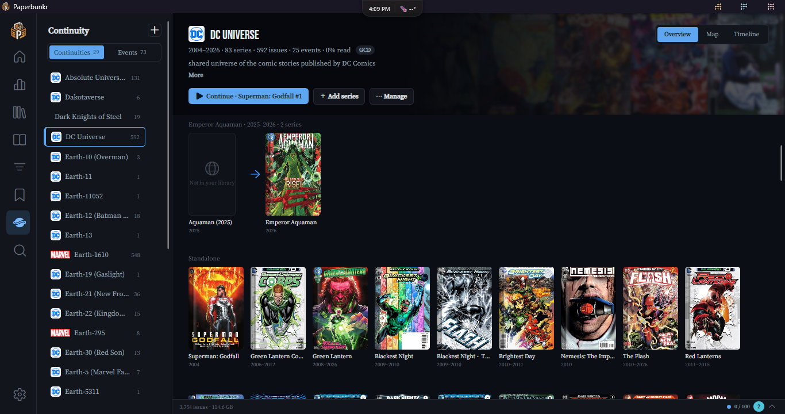
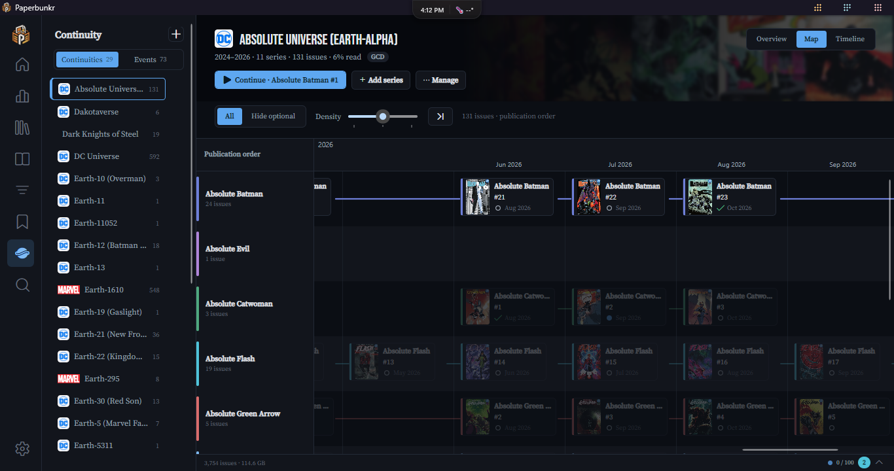

# Story Events & Relations

PaperBunkr models how your series and issues connect — sequels, crossovers, shared
universes, publishing timelines. This drives the series detail tabs and the
[Home recommendations](Home-Dashboard-and-Recommendations).

## Series detail tabs

Open a series and use the tabs:

### Related

Series connected to this one. **+ Add Related Series** to link a title and set the
**relationship** (sequel, prequel, spin-off, adaptation, alternate version, …). The link
is bidirectional and shown on both series.

With the [Grand Comics Database data](#grand-comics-database-data) installed, series that continue each other (renumberings,
renames, reboots) are linked for you and marked **GCD**. Continuations to series you don't have are listed under **Not in your
library**, each with a link to its page on comics.org.

#### Relations found for you

PaperBunkr also links series on its own, and the small line under each card says why:

- **Later volume / Earlier volume**: two series with the same title and publisher whose runs follow each other.
- **Annual, Special, Rebirth, Giant-Size, …**: a companion title, linked to the volume of the main series it sits beside.
- **Team-up title**: "Batman/Superman" or "Avengers/X-Men" is linked to each series it names.
- **Crossover · *event***: a story event shared by two or three series that has no main series.
- **Metron**: Metron lists the two series as belonging together. A series that has no Metron id yet is looked up by its
  ComicVine or GCD id, so ComicVine-scraped series take part too.

**Dimmed cards** at the end of the Related row are suggestions: series that share a lead character, a writer, or most of a title,
or that look like a spin-off. **✓** saves the suggestion as your own relation, and **✕** hides it for good.

Removing a relation PaperBunkr made (✕ on its card) also stops it from coming back. Relations you made yourself are never changed.
This runs after every scan and scrape, and once a week as **Find related series** in Preferences → Automation (which also asks
Metron). **Find relations** at the top of the tab runs it now. Turn it off under Preferences → Library → **Find related series
automatically**.

#### Event rows

Each story event the series is part of gets its own row: the event's **main series** first, then the series that tie into it,
each with the issues that do ("#33–34"). **open event** goes to the event's page. The three newest events show; **Show all**
lists the rest. Big events with no main series (Convergence-style, with no series named after the event) are gathered under
**Other events**, one card per event.

### Continuities

**+ Add to Continuity** groups the series into a shared timeline / universe (e.g. a
publisher's main continuity, or a self-contained reboot). Series in the same continuity
surface each other as "Same Continuity".

### Trackers

**+ Link for Tracking** connects the series to an external service so its status and issue
list can be checked. **Sync to Trackers** pushes your progress out (where the adapter
supports it).

### External Metadata

**+ Link External Metadata** attaches an online source record (see
[Metadata & Editing](Metadata-and-Editing)) used for lookups and enrichment.

### Activity

A log of recent changes and reading activity for the series.

## Story Events

**Story Events** are curated event timelines — a company-wide crossover, an arc that spans several series. Each event has an
**ordered reading list** of issues. Events and continuities share the **Continuity** screen on the navigation rail.

### The Continuity screen

- **Sidebar.** A **Continuities | Events** switch at the top (it remembers the last one you used). Continuity rows show the
  publisher's logo and how many issues the continuity holds; event rows show the start year and issue count. **＋** makes a new
  continuity or event. Right-click a row to open, edit or delete it.
- **Suggestions & checks**, the row under the list, opens one panel with everything waiting for a decision: new story-event
  suggestions, possible duplicate events and any shared-universe suggestions, plus the **Check story events** button.
  Its badge counts what's waiting.
- **Every page** has a hero band across the top: a blurred collage of covers, the name, a stats line and the buttons, with
  **Overview | Map | Timeline** on the right.

**A continuity's Overview:**

- **Stats:** the years it covers (on-sale dates from the Grand Comics Database data when you have it), series, issues, events
  and how much you've read. A **GCD** chip shows when its series are matched to that data.
- **▶ Continue** opens the first unread issue in the continuity map's order, then reading carries on in that issue's own order.
- **Needs attention** appears only when something's waiting: possible duplicate events, event connections to review, or series
  that its events use but that aren't in the continuity (each with **Add**).
- **Series** are grouped into **runs**: series that continue each other sit in one row, oldest first, joined by arrows. A
  continuation you don't have shows as a dimmed "Not in your library" poster that opens its page on comics.org. Everything else is
  **Standalone**. Switch **Order** to **Custom** to see your own arrangement instead and drag posters to change it (or Ctrl + ← / →
  on a poster); that order sets the map's lanes and the reading-list export. Hover a poster to add a note or remove it.
- **Events in order** lists the continuity's events in the order they happen, with how much of each you've read, a line where one
  leads into the next, and a **Map** button.
- **⋯ Manage** has Edit details, **Compare & merge** (this continuity, what you share and the other side by side, with **Merge
  into …**), Create reading list, and Delete.

**An event's Overview:**

- **Stats** with where it came from (ComicVine, Metron, both, or *Yours*) and which continuity it's in.
- **Follows ← This event → Followed by** shows the events before and after it; right-click one to unlink it.
- **Needs attention** points at role suggestions, issue suggestions, connections to review and possible duplicates.
- **The reading list** stays in reading order; the chips filter it (**All**, **Core**, **Hide optional**, **Unread**, and
  **Needs review** when roles await a decision). Covers show a tick once read. **＋ Add issues** searches your library; the **⋮**
  menu on a row sets the role, moves it up or down, or removes it.
- **Related events** (crossovers and other links) and **Issue suggestions** fold open below.

### Event Map

Switch an event to **Map** (the **Overview | Map | Timeline** toggle) to see it as a swimlane timeline: one lane per
series, laid out in the event's reading order.

- **Spine.** A saved choice wins; otherwise your own tie-in and main-series relations can identify the main series. If they do not,
  a series matching the event's name (for example *Secret Wars* in the *Secret Wars* event) becomes the **spine**, a trunk lane across the top. Each other series hangs off it: a dashed line shows
  which spine issue a tie-in follows, and Prologues and Epilogues sit on the spine too. If neither rule identifies a spine, the map
  is a **relay**: a single line follows the reading order from lane to lane. Pick a different
  spine, or **None (relay)**, from the **Spine** box. Your choice is saved with the event.
- **Filters:** **All**, **Spine only**, or **Hide optional** (drops issues marked *Optional*).
- **Layout:** relay maps normally pack consecutive issues from different lanes into the same column. Choose **One per column** to
  spread them out again. On larger maps, short tie-in lanes fold together; click the folded lane or use **More** to unfold it.
  **Hide read** removes finished issues and closes their gaps; **Show read** brings them back. A selected issue marked read stays
  until you move the selection or close its inspector.
- **Zoom:** use the slider, **Ctrl + mouse wheel**, or a pinch gesture to move smoothly from a whole-map view of dots through
  badges and cards to full covers. **Fit map** fits the whole map. Drag empty space to pan; the wheel scrolls vertically and
  **Shift + wheel** scrolls sideways. The overview strip appears when the map does not fit: drag its viewport or click to move.
- **More room:** the corner button switches between slim and wide lane headers. The inspector floats over the map by default;
  its pin docks it beside the map. Both choices are remembered. **Maximize map** or **F11** hides the surrounding app chrome until
  you restore it, switch to Overview or Timeline, or leave the screen.
- **Selecting a card** dims everything unrelated to it and opens the inspector. The inspector shows the cover and
  summary, **Open reader**, **Mark read / unread**, and links to the issues it follows, leads to and ties into. On a
  spine map it also shows the reading order of that stretch. Click a link to jump to that card.
- **Keyboard:** ← / → move in reading order, ↑ / ↓ move to the nearest card in the lane above or below, Home / End go
  to the first or last card, Enter opens the inspector, Ctrl + Enter (or a double-click) opens the reader, Esc closes
  the inspector, then clears the selection, then restores the map from Maximize.
- **Reading from the map** follows the event's order: Next and Previous issue, the end-of-issue card and the context
  strip all stay inside the event and stop at its last issue. Coming back, the map re-selects the issue you were
  reading.
- **Progress line.** Lines into issues you've read draw solid in the accent colour; the rest stay thin and faded, so how far you
  are is the shape of the map. A ring marks **You are here**, the next issue to read (on a spine event, the next spine issue). It
  pulses slowly, and stays still when motion is reduced. **More → Hide progress line** turns the line off; the choice is
  remembered.
- **Selecting a card** traces its connections outward from it, hop by hop, and lights up the related cards in order (instant
  when motion is reduced).
- **Save as image** (**More**) saves the whole Map or Matrix as a PNG with the event's name and your progress. A very large map is
  saved at a smaller card size so the image stays under 16,000 pixels on a side.

### Matrix, List and Atlas

The first switch in the map's toolbar changes how the same event or continuity is shown. Your selection, filters and hidden
series carry across.

- **Matrix:** one row per series, one column per stretch of the story: the spine's chapters on a spine event, one column per event
  on a continuity, groups of eight reading positions on a relay. Each cell shows how many issues that series has there and a
  ring for how many you've read; the **Total** column sums each row. Click a cell to see its issues underneath, double-click to open
  that issue on the Map. **Covers** shows small cover stacks instead.
- **List:** the reading order as a list, in sections (the spine's chapters, the continuity's events, or groups of ten). The jump
  bar on the left shows each section's progress; click one to go there. Sections collapse, the section you're in stays pinned at the
  top, **Read this section** opens its first unread issue, and the next issue to read is marked **Next up**.
- **Atlas** (continuities only): each event as a bar across the years, thicker for bigger events and filled as you read it, with
  lines for prequels and sequels. A faint band along the bottom shows where issues in no event cluster. Click a bar to open that
  event's map; **Ctrl + mouse wheel** zooms the years and **Fit atlas** shows them all. Events with no dates are listed under
  **Undated**.
- **Series** opens a list of every series in the map with how many issues you have and have read. Click a name to jump to it;
  untick it to hide that series everywhere until you leave the screen (**Show all** brings them back).

### Missing issues

When an event is linked to its Metron or ComicVine arc (Smart fill does this), Paperbunkr keeps that arc's issue list.

- **Show missing** puts the issues you don't have on the map as dashed cards, each after the issue it follows in the list: *Not in your
  library*, or *In your library* for one you own that isn't in the event yet. They never count as read and never open in the reader.
- Select one for **Add to Wanted** (it starts tracking the series if needed, after asking once) or **Add to event**. **Add all missing to
  Wanted** does the lot, and **Undo add to Wanted** takes the last request back.
- **More → Check for missing issues** fetches the lists again. With no list, **Possible gaps** lists numbers missing between a series'
  issues in the event that you don't own.

### Characters, creators and arcs on the map

- **Featuring** picks a character or team: everything else dims, or **Hide others** removes it. Character and team pages, and the
  continuity Overview's Key characters, have **Open on map** buttons that open the map featuring them.
- Cards show the issue's main character or team as a small face when it has an image.
- **Colour by** Writer or Artist colours the six creators with the most issues and lists them in a legend (click one to single them out),
  and draws their runs as brackets under the lanes. **Read state** colours by what you've read. **Show arcs** draws story arcs under the
  lanes too.

### Continuity map

A continuity has a map too (**Overview | Map | Timeline**). It shows every issue of every story event that includes one of the
continuity's series on one swimlane, events in chronological order:

- **Event bands.** The ruler names each event over its stretch of the map; click the name to open that event's own map, or double-click
  a band to fit its columns in the viewport. Every
  other event is lightly shaded so the events read as bands. A band carries a soft wash of the event's cover when it has one, and a
  thin bar along its bottom shows how much of that event you've read.
- **Issues in no event** are placed between the events by date (the on-sale date from the Grand Comics Database data when
  you have it, otherwise the cover date), under "Between events · 2004–2006" bands. **Events only**
  hides them; **Events…** lets you hide whole events.
- **An issue in two events** appears once, in the first; its card lists the other under **Also in**.
- **Series outside the continuity** that an event pulls in get their own lane, marked *outside this continuity*.
- **A series that continues another** (a GCD link, or a Continuation relation you set) gets the lane right below the one it
  continues, and that lane says *continues as ↓*.
- **Connectors** between event bands show how events relate: an arrow for Prequel, Sequel or Continues, a bracket for a
  Crossover. Solid lines are relations you set; dashed ones were worked out automatically. Hover for the reason.
- **Open reader** follows the order of the event the card sits in.
- A continuity with no events shows its series in **publication order**, in year bands.

### How events are connected

**Check story events** (in **Suggestions & checks**, and the weekly task of the same name in Preferences → Automation) also works out
which events come before which:

- **From your library**, when an event picks up exactly where another left off in a shared series (Hulk #105, then #106), when
  a name says so ("Prelude to …", "… : Aftermath"), or when one event's issues all come before another's in the series they share.
- **From Metron's reading lists**, where the community has put one event's reading list before another's (for example
  *Planet Hulk* → *World War Hulk*). This needs your Metron login in Preferences → Connections.

It also looks up where each event sits in a reading order, so the map and timeline put events in the order people read them:

- **Comic Book Reading Orders** keeps a story order of the Marvel and DC events. Events it lists are placed in that order, even
  when their own dates disagree (a collected edition dated years after the story). It is checked at most once a week and no
  more than one page every five seconds, as the site asks.
- **Dates** from the Grand Comics Database (when installed), then the issues' cover dates, place everything else.
- An event no source can place goes by its own dates, with nothing to review.

A date order on its own is never turned into a "sequel": it only places the event.

Before/after links show in an event's **Follows / Followed by** strip and crossovers under **Related events**, where the
automatic ones are marked *inferred* or *Metron*. Relations you set yourself are never changed, and removing an automatic one
stops it coming back. Under **Suggested** you'll still see events that look connected (a shared word in the name, close dates,
a shared series); **Accept** connects them as *Related* and **Dismiss** hides them.

### Grand Comics Database data

The [Grand Comics Database](https://www.comics.org) (GCD) records when series continue each other and when issues went on
sale. PaperBunkr can use a compact copy of it (about 34 MB):

1. Open **Preferences → Connections → Grand Comics Database data** and click **Download**.. After it installs, your series are matched to it. Series scraped from Metron use Metron's own GCD ids. The rest are
  matched by name, start year and publisher, and only when exactly one GCD series fits.. The weekly task **Match series to GCD** (Preferences → Automation) keeps new series matched.

**Check for update** looks for newer data, and **Remove** deletes it along with every GCD link. Deleting a GCD link on a series'
Related tab stops it from coming back. The data is licensed CC BY-SA 4.0; the credit is in the Preferences row and under About →
Legal & notices. The data is published at
[heisehis/paperbunkr-gcd-data](https://github.com/heisehis/paperbunkr-gcd-data), one release per GCD data dump.

### Duplicate events (ComicVine vs Metron)

ComicVine and Metron often spell the same arc differently: ComicVine's "Hulk: Planet Hulk" is Metron's "Planet Hulk". Issues
scraped from each site could end up in two separate events. PaperBunkr now works out which events are the same arc and merges them.

- **It looks up both ids.** For each event, PaperBunkr asks ComicVine and Metron for their id for the arc. It uses what the event's
  own issues say, Metron's link to ComicVine, and a name search checked against the arc's issue list. Two events that turn out
  to have the same id are the same arc.
- **Sure matches are merged for you.** That means two events created from suggestions or look-ups that share an id, or whose names
  match (ignoring a series prefix such as "Hulk:") *and* that share at least half their issues. The merged event keeps the name
  without the prefix, remembers the other spelling, and keeps both ids, so that spelling is never suggested as a new event again.
- **Anything less certain waits for you** under **Possible duplicates** in **Suggestions & checks**, with **Merge** or
  **Not the same**. "Not the same" is remembered. Events you made or renamed yourself are never merged without asking, and their
  names are kept.
- **Sources disagree:** if ComicVine or Metron give an event two different ids, it's listed with **Check again** instead of being
  merged.
- **When it runs:** right after you accept a suggestion (for that event), weekly as the **Check story events** task in
  Preferences → Automation, and whenever you click **Check story events**. It works through a batch per run and re-checks an
  event after 30 days or when its issues change. Results appear in the Activity Center.

### Suggested Story Events and Continuities

PaperBunkr can propose Story Events and Continuities for you. **Nothing is created until you click
Accept**, and anything you **Dismiss** stays dismissed.

- **Story Events** — issues that share a Story Arc (per publisher) are grouped into a suggested
  event, optionally checked against ComicVine or Metron. Suggestions refresh weekly in the
  background and wait in **Suggestions & checks**. In **Issue Properties**, a look-up
  button checks a single issue.
- **Continuities** — a series joins a continuity from the universes **Metron** lists for its issues
  (Earth-616, Earth-1610 and so on, across many publishers), as soon as you scrape it. The weekly **Check
  story events** also fills in each universe's designation, shown as a small tag on the continuity's page.
  Wikidata is no longer asked in the background or from **Suggestions & checks**; if you want it for one
  series, use **Look up on Wikidata** on its **Continuities** tab (it covers few publishers, mostly Marvel
  and DC). Accepting a suggestion fills in the continuity's Wikidata ID, description and publisher.

Progress for the manual checks shows in the Activity Center.

A [Reading List](Reading-Lists) can be **linked** to a Story Event so the two stay in
sync. Issues that share an event show "Same Event" on their detail pages.

## Roles are detected for you

Each issue in a story event or reading list can be a **Prologue, Core, Tie-in, Epilogue, Optional or Aftermath**. Paperbunkr suggests these from what it can see:

- a reading-order site's own section headings and notes ("Prelude", "Tie-Ins"), when the list was built from a story arc;
- the issue's **Format** (Prologue, Minus 1, Epilogue);
- words in the issue's title - *prologue*, *prelude*, *epilogue*, **aftermath**, *tie-in* - or an issue number of 0 or -1;
- for lists built from ComicVine, the issue's story title there (which exists even for issues you do not own yet) counts like a title in your library, and its one-line summary is a weak hint;
- weaker hints: the same words only in the series name, or an issue from a different series than the rest of the arc.

When the evidence is strong the role is filled in for you and marked **· auto** (hover for why). A role you set yourself is never changed. A weaker guess, or a different idea about a role you set, appears as a **Suggested** chip with **Accept** and **Dismiss**. **Detect roles** in the ⋯ menu of an event or list runs detection over everything in it, and **Clear detected role** takes an automatic role back off. *Optional* is never suggested - only you mark an issue optional.
